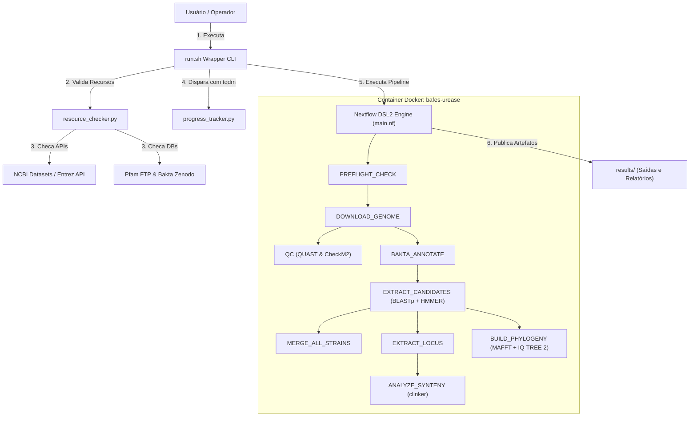
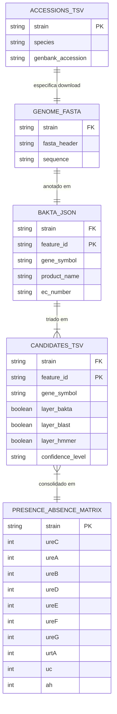

# BAFES-urease-mining

[](README.md)
[](README.en.md)

> 🌐 **Alternar Idioma / Language Switch**: Leia esta documentação em [English-US](README.en.md).

---

## Resumo do projeto

O **BAFES-urease-mining** é um pipeline automatizado de bioinformática, desenvolvido em Nextflow DSL2 e Python 3.11 e executado em um container Docker. Ele realiza a prospecção genômica, a identificação funcional e a análise evolutiva de genes envolvidos no catabolismo da ureia em genomas bacterianos.

O pipeline analisa os genomas informados — accessions do GenBank/RefSeq e, opcionalmente, montagens genômicas locais em FASTA (assemblies; ver [Genomas de entrada](#genomas-de-entrada)) — e investiga três sistemas relacionados ao metabolismo da ureia:

1. **Via Canônica da Urease**: Subunidades catalíticas ($\gamma$ - UreA, $\beta$ - UreB, $\alpha$ - UreC) e proteínas acessórias de maturação (UreD, UreE, UreF, UreG).
2. **Sistema de Transporte Ativo de Ureia**: Complexo ABC $urtABCDE$ (UrtA, UrtB, UrtC, UrtD, UrtE).
3. **Via alternativa independente de níquel**: ureia carboxilase (`uc`) acoplada à alofanato hidrolase (`ah`).

**Conjunto de dados de exemplo.** O repositório vem configurado para analisar 10 BAFES
(Bactérias Aeróbicas Formadoras de Endósporos) da coleção CBAFES/UnB, isoladas de solos do
Distrito Federal. Seus accessions (`VKHW00000000.1` a `VKIC00000000.1`) estão em
[data/accessions.tsv](data/accessions.tsv). Ao longo deste README, os números e nomes de estirpes
(S1, S2–S10) se referem a esse conjunto e são apenas ilustrativos.

### Genomas de entrada

O pipeline roda sobre os genomas listados em até dois arquivos TSV, com cabeçalho e separados por
tabulação:

| Arquivo | Opção | Colunas | Para quê |
| :--- | :--- | :--- | :--- |
| `accessions.tsv` | `--accessions` (padrão: `data/accessions.tsv`) | `strain`, `species`, `genbank_accession` | Genomas públicos, baixados do NCBI. Aceita o accession de um assembly (`GCA_`/`GCF_`) ou um WGS master (`VKHW00000000.1`), que é resolvido para o assembly antes do download. |
| TSV de genomas locais | `--local-genomes` (opcional) | `strain`, `species`, `fasta` | Montagens genômicas que não estão no NCBI. O caminho do FASTA é relativo ao diretório em que o comando é executado. O genoma local não é baixado e segue diretamente para o QC e a anotação com Bakta. Exemplo: [data/local_genomes.tsv](data/local_genomes.tsv). |

Regras:

- `strain` é o identificador curto usado nos nomes dos arquivos de saída (`results/00_genomes/{strain}.fna`,
  `{strain}_candidates.tsv`, …). Ele deve ser único nos dois arquivos: se houver um ID repetido,
  o pipeline encerra antes de iniciar qualquer tarefa.
- `species` é informativo (aparece no relatório); pode ser `Unknown`.
- Todo genoma, baixado ou local, passa pela mesma validação: presença de contigs, pelo menos
  500 kb e sequência formada por nucleotídeos válidos. Um genoma inválido ou cujo download falhe
  interrompe a execução inteira (estratégia padrão de erro do Nextflow); corrija ou remova a linha
  e retome com `--resume`.
- A pré-checagem exige pelo menos um accession em `accessions.tsv`.

```bash
# Outros genomas públicos
./run.sh --exec --accessions minha_lista.tsv --outdir results_minha_lista --verbose

# Genomas públicos + assemblies locais
./run.sh --exec --accessions minha_lista.tsv --local-genomes meus_fastas.tsv --verbose
```

Duas escolhas dependem do grupo taxonômico dos genomas de entrada:

- **Referências do BLASTp.** O conjunto padrão é de Firmicutes, o filo do conjunto de exemplo.
  Para genomas de outros grupos, ajuste a consulta com `fetch_references.py --query` (ver
  [Conjunto de referências](#conjunto-de-referências)).
- **Recursos.** O tempo de execução cresce com o número de genomas. Os limites de CPU e memória
  em [nextflow.config](nextflow.config) foram definidos para um host de 96 núcleos, permitindo
  que até 10 estirpes executem o hmmscan em paralelo.
---

## Quick Start

### Pré-requisitos

As etapas de bioinformática são executadas **dentro do container** `bafes-urease`. No host, são necessários apenas:

- Docker Engine >= 24.0 (com o usuário no grupo `docker`)
- Git, Bash e `curl`
- Espaço em disco: **~160 GB livres** para o banco completo do Bakta (use `--bakta-db-type light`
  para ~10 GB, ou `--skip-bakta-db` se já tiver o banco)

Nextflow, Bakta, BLAST+, HMMER, MAFFT, trimAl, IQ-TREE, QUAST e clinker vêm todos na imagem —
não é preciso instalar nada disso no host. Para rodar sem Docker (com Conda/Mamba já configurado),
use `--runtime local`.

### Sequência recomendada em três passos

```bash
# Clonar e habilitar o wrapper
git clone https://github.com/waldeyr/bafes-urease.git
cd bafes-urease
chmod +x run.sh

# Passo A: Bootstrap — constrói a imagem e baixa Pfam e o banco completo do Bakta
./run.sh --bootstrap --runtime docker --container-image bafes-urease

# Passo B: Build e pre-flight check — valida o ambiente e o acesso aos recursos externos
./run.sh --build --runtime docker --container-image bafes-urease

# Passo C: Executa o pipeline com log detalhado e barras de progresso do tqdm.
#          Quando o pipeline terminar, abra results/index.html para consultar o relatório consolidado.
./run.sh --exec --runtime docker --container-image bafes-urease --verbose
```

O `--bootstrap` é idempotente: cada etapa concluída é pulada nas execuções seguintes.

Cada invocação do `run.sh` devolve o prompt imediatamente; o processo continua em uma sessão
`screen` destacada. Veja [Sessão `screen` automática](#7-sessão-screen-automática) para acompanhar
o log e consultar o código de saída real. Outras combinações de parâmetros (banco reduzido,
retomada de execução interrompida, caminhos alternativos e execução sem container) estão em
[Instalação e uso](#instalação-e-uso).

---

## Principais funcionalidades

- **Verificação prévia de recursos e conectividade**: Verifica o acesso aos accessions no NCBI e a conectividade com os serviços do Pfam (EMBL-EBI FTP) e do Bakta (Zenodo), antes de iniciar etapas de alto custo computacional.
- **Download automático de genomas**: Baixa assemblies FASTA pelo NCBI Datasets CLI, com fallback para o NCBI Entrez E-utilities. Genomas locais podem ser informados com `--local-genomes` e passam pela mesma validação.
- **Controle de qualidade genômica (QC)**: QUAST calcula métricas de contiguidade (N50, L50, GC%); CheckM2 estima a completude e a contaminação.
- **Anotação genômica estrutural e funcional**: Bakta v1.9+ gera arquivos JSON, GFF3, FAA e GBFF.
- **Triagem de candidatos em três camadas**: Consolida evidências da anotação Bakta (Camada A), do BLASTp contra referências do UniProt (Camada B) e da busca de domínios Pfam com HMMER3 (Camada C).
- **Matriz de presença e ausência**: Gera a tabela `urease_presence_absence.tsv` e um resumo com os resultados de todas as estirpes de entrada.
- **Análise de vizinhança gênica (sintenia)**: Extrai regiões ancoradas em candidatos de alta confiança, genes da via ou perfis Pfam diagnósticos, com até cinco genes flanqueadores de cada lado, e gera um mapa interativo com `clinker`.
- **Reconstrução Filogenética de UreC**: Alinhamento múltiplo com MAFFT, filtragem de posições conservadas com trimAl e inferência de árvore por Máxima Verossimilhança com IQ-TREE 2.
- **Acompanhamento de Progresso por tqdm**: Exibição de barras de progresso interativas gerais e por fase (0 a 100%) através do wrapper `run.sh`.

---

## Arquitetura

### Diagrama de componentes



Após o download, QC e anotação com Bakta são executados em paralelo. Depois da triagem, a matriz,
o mapa de sintenia e a filogenia são gerados em ramos independentes.

### Tecnologias e suas versões

| Tecnologia / Ferramenta | Versão | Função no Sistema |
| :--- | :--- | :--- |
| **Linux Ubuntu (Jammy)** | 22.04 LTS | Sistema operacional base do container Docker |
| **Python** | 3.11.x | Linguagem para scripts auxiliares, consolidação e tqdm |
| **Java Runtime Environment**| 17.0+ | Pré-requisito para execução do Nextflow |
| **Nextflow** | >= 24.04.0 | Motor de orquestração de workflows bioinformáticos |
| **Docker** | >= 24.0+ | Engine de containerização e isolamento do ambiente |
| **NCBI Datasets CLI / Entrez** | v2 / E-utils | Download e busca de assemblies no GenBank |
| **Bakta** | >= 1.9.0 | Anotação genômica funcional estruturada |
| **QUAST** | >= 5.2.0 | Avaliação de métricas de contiguidade genômica |
| **CheckM2** | >= 1.0.2 | Avaliação de completude e contaminação bacteriana |
| **BLAST+ (blastp)** | >= 2.14.0 | Alinhamento local contra referências proteicas |
| **HMMER3 (hmmscan)** | >= 3.3.2 | Busca de domínios conservados contra banco Pfam-A |
| **clinker** | >= 0.0.28 | Visualização interativa de sintenia e vizinhança gênica |
| **MAFFT** | >= 7.520 | Alinhamento múltiplo de sequências de aminoácidos |
| **trimAl** | >= 1.4.1 | Remoção de posições mal alinhadas ou com gaps |
| **IQ-TREE 2** | >= 2.2.0 | Inferência de árvores filogenéticas por Máxima Verossimilhança |
| **pandas / tqdm / Biopython** | Últimas estáveis | Manipulação de matrizes, barras de progresso e FASTA |

---

## Detalhamento das etapas

### Entradas, saídas e regras

| Etapa | Entrada | Saída | Regras |
| :--- | :--- | :--- | :--- |
| **Verificação prévia de recursos** | `--accessions`, `--references` | Log do console / `preflight_status.txt` | Verifica resposta HTTP 200/JSON no NCBI, no Pfam da EBI e no Bakta do Zenodo. Encerra com código 4 se um recurso crítico estiver inacessível. |
| **Download de genomas** | `genbank_accession` em `data/accessions.tsv`; `fasta` no TSV de `--local-genomes` | `results/00_genomes/{strain}.fna` | Resolve o accession WGS master para o assembly (GCA_/GCF_) e baixa o genoma via NCBI Datasets CLI, com fallback para o FTP do assembly. Genomas locais seguem para validação sem serem baixados. Todos são validados quanto a contigs, número de bases e alfabeto. **A etapa falha se não obtiver um genoma válido.** |
| **QC de genomas** | FASTA de cada genoma | `results/01_qc/quast/` e `results/01_qc/checkm2/` | QUAST calcula N50, GC% e comprimento total; CheckM2 estima completude e contaminação usando o banco baixado no bootstrap. |
| **Anotação com Bakta** | FASTA do genoma + `--bakta_db` | `results/02_bakta/{strain}/` (.json, .gff3, .faa, .gbff) | Atribui identificadores RefSeq/UniRef, termos EC (3.5.1.5, 6.3.4.6, 3.5.1.54) e símbolos gênicos. |
| **Triagem de candidatos** | JSON do Bakta, `urease_references.fasta`, `Pfam-A.hmm` | `results/03_candidates/{strain}/{strain}_candidates.tsv` | Classifica a evidência em três camadas: Bakta (A), BLASTp (B, E-value <= 1e-5, identidade >= 30% e cobertura >= 50%) e HMMER (C, score de domínio >= 20). A confiança segue a [pontuação](#pontuação-da-triagem-de-candidatos): Alta (>= 2 pontos), Média (1) ou Baixa (somente BLASTp contra TrEMBL). |
| **Consolidação de Matriz** | Candidatos TSV de todas as estirpes | `results/04_summary/urease_presence_absence.tsv` | Cria matriz binária (0/1) para os 11 genes alvo ($ureA$–$ureH$, $urtA$, $uc$, $ah$) por estirpe. |
| **Análise de sintenia** | Arquivos GBFF dos loci extraídos | `results/05_synteny/synteny.html` | Extrai regiões ancoradas em candidatos de alta confiança, genes da via ou perfis Pfam diagnósticos, com até cinco genes flanqueadores de cada lado, e executa `clinker`. São necessários pelo menos dois genomas com um locus extraído. Se houver menos de dois arquivos GenBank ou se `clinker` falhar, a etapa falha explicitamente; nenhum HTML de placeholder é escrito. |
| **Filogenia de UreC** | UreC selecionado a partir dos TSVs de candidatos | `results/06_phylogeny/ureC.treefile`, `ureC_labels.tsv`, `phylogeny_status.txt` | Usa **apenas** as sequências de UreC identificadas na triagem, não o proteoma inteiro, mais as UreC de referência e o grupo externo (`data/urec_outgroup.fasta`). Exige >= 3 UreC; abaixo disso registra o motivo em `phylogeny_status.txt` e não gera árvore. MAFFT -> trimAl `automated1` -> IQ-TREE 2 (`-m MFP`, 1000 ultrafast bootstraps, enraizada no grupo externo com `-o`). |
| **Acompanhamento com tqdm** | Execução via `run.sh --exec` | Barras de progresso no terminal | Exibe o percentual de conclusão de cada fase e do pipeline. |

### Pontuação da triagem de candidatos


Cada camada vale 1 ponto, com uma exceção: o BLASTp cujo **melhor acerto** é uma referência do
TrEMBL (não revisada) é registrado, mas não pontua. A anotação do TrEMBL é automática, como a do
Bakta, então concordar com ela não é evidência independente. O status do melhor acerto fica na
coluna `blast_ref_status`, e os pontos em `evidence_points`.

| Evidência | Pontos |
| :--- | :--- |
| Camada A — Bakta: gene alvo, número EC ou produto \* | 1 |
| Camada B — BLASTp com melhor acerto em referência revisada (Swiss-Prot) | 1 |
| Camada B — BLASTp com melhor acerto em referência não revisada (TrEMBL) | 0 (registrado) |
| Camada C — HMMER: perfil Pfam da lista, score de domínio >= 20 \* | 1 |

| Pontos | Confiança |
| :--- | :--- |
| >= 2 | Alta |
| 1 | Média |
| 0, com BLASTp contra TrEMBL | Baixa |

| Exemplo | Pontos | Confiança |
| :--- | :--- | :--- |
| Bakta + BLASTp (Swiss-Prot) + HMMER | 3 | Alta |
| Bakta + BLASTp (Swiss-Prot) | 2 | Alta |
| Bakta + HMMER + BLASTp (TrEMBL) | 2 | Alta |
| Bakta + BLASTp (TrEMBL) | 1 | Média |
| HMMER + BLASTp (TrEMBL) | 1 | Média |
| Só Bakta, ou só HMMER | 1 | Média |
| Só BLASTp (TrEMBL) | 0 | Baixa |

\* **Regras para a família KipI/PxpABC (5-oxoprolinase).**

- Genes `pxpA/B/C` e `kipI/A` são excluídos da Camada A, mesmo quando o produto contém
  "allophanate" ou há anotação EC 3.5.1.54 (`kipI_family`).
- O domínio CT_C_D (PF02682) só conta na Camada C quando a mesma proteína também tem um domínio de
  biotina carboxilase (PF00289, PF02786 ou PF02785), arquitetura da ureia carboxilase. CT_C_D
  isolado não conta (`ct_c_d_without_bc`). Uma ureia carboxilase distribuída entre subunidades
  separadas também não conta.
- A matriz (`merge_strain_results.py`) e o destaque dos mapas de sintenia (`generate_report.py`)
  não classificam produtos de genes KipI como `uc` ou `ah`.

As evidências retiradas por essas regras são registradas em `_filtered.tsv`, com o motivo. Na
consulta padrão, UrtA–E, `uca` e `atzF` são recuperados por nome exato do gene. UrtA–E e `atzF` não
têm perfil próprio na lista da Camada C; para `uca`, CT_C_D pode contribuir quando está na mesma
proteína que a biotina carboxilase. Um FASTA de referências próprio (`--references`) cujo cabeçalho
não siga o formato `ref|gene|UniProt:acesso|organismo|status|Naa` recebe status `unknown` e pontua
como revisado.

#### Filtros antes da pontuação

UrtD e UrtE são ATPases de um transportador ABC, uma família ampla. Para restringir os acertos
TrEMBL a correspondências mais próximas e confirmar o contexto do transportador, dois filtros são
aplicados antes da pontuação:

| Filtro | Regra | Parâmetro (padrão) |
| :--- | :--- | :--- |
| Identidade TrEMBL | Um acerto de BLASTp contra referência não revisada só conta com identidade >= 80 %, além dos limiares gerais (E <= 1e-5, identidade >= 30 %, cobertura >= 50 %) | `--trembl_min_identity` (80) |
| Contexto de operon | UrtB–E (pelo gene do Bakta ou pela referência do melhor acerto) só contam se houver uma UrtA no mesmo contig, a até 5 CDS de distância. Sem ela, a evidência `urt` é retirada; a linha também é removida se não restar outra camada | `--urt_operon_window` (5) |

Toda evidência filtrada é registrada em
`results/03_candidates/{strain}/{strain}_filtered.tsv`, junto com a referência, a identidade e o
motivo. O relatório também apresenta a contagem por motivo.

---

## Integridade dos dados

O pipeline **não fabrica dados em nenhuma hipótese**. Toda etapa que não consegue produzir
um resultado real a partir dos genomas de entrada falha explicitamente (exit != 0) em vez de
substituir a saída por um valor plausível. Em particular:

- **Genomas.** Accessions WGS master (como os do conjunto de exemplo, `VKHW00000000.1`) não
  contêm sequência — um `efetch` neles devolve zero bytes. O
  [download_genome.py](bin/download_genome.py) resolve o accession para o assembly
  (`GCA_`/`GCF_`) antes de baixar, e valida contigs, número de bases (>= 500 kb) e alfabeto
  nucleotídico. Sem genoma real, a estirpe não segue no pipeline.
- **QC.** CheckM2 é executado de verdade contra seu banco. Não há valores de
  completude/contaminação escritos no código.
- **Anotação.** Sem o banco do Bakta, [BAKTA_ANNOTATE](main.nf) falha. Não há anotação
  substituta com genes inventados.
- **Referências.** As sequências de [urease_references.fasta](data/urease_references.fasta) e do
  grupo externo [urec_outgroup.fasta](data/urec_outgroup.fasta) são baixadas do UniProt por
  consulta REST (detalhes em [Conjunto de referências](#conjunto-de-referências)). Nada é
  sintetizado localmente — falha de rede, resposta truncada ou conjunto vazio abortam sem
  escrever nenhum dos dois arquivos. Regenere com:
  ```bash
  python3 bin/fetch_references.py
  ```
- **Sintenia e filogenia.** Nenhum HTML de placeholder e nenhuma árvore parcial. Quando há
  menos de 3 sequências de UreC, isso é registrado em `phylogeny_status.txt` como resultado
  legítimo — não há árvore possível — e nenhum arquivo de árvore é escrito.

### Conjunto de referências

| Item | Valor |
| :--- | :--- |
| Consulta | `(taxonomy_id:1239) AND (((protein_name:urease) AND (reviewed:true)) OR (gene_exact:urtA OR … OR gene_exact:urtE OR gene_exact:uca OR gene_exact:atzF))` |
| Endpoint | `https://rest.uniprot.org/uniprotkb/stream` (FASTA comprimido) |
| Escopo | Firmicutes. Urease (UreA–I): apenas entradas revisadas (Swiss-Prot). Transporte (UrtA–E), ureia carboxilase (`uca`) e alofanato hidrolase (`atzF`): entradas revisadas ou não revisadas (TrEMBL) |
| Redundância | Uma sequência para cada gene em cada espécie; entradas revisadas têm preferência, depois é escolhida a menor acessão (`--keep-redundant` desliga essa regra) |
| Tamanho mínimo da resposta | 100 sequências; respostas menores são consideradas truncadas e interrompem a execução |
| Grupo externo | Sequências UreC revisadas de *Klebsiella aerogenes* (P18314) e *Proteus mirabilis* (P17086), em `data/urec_outgroup.fasta` — usadas apenas na árvore, fora do BLASTp |
| Procedência | `data/urease_references.provenance.txt` e `data/urec_outgroup.provenance.txt` — release, data, contagens e `sha256` |

O conjunto é obtido por uma consulta dinâmica ao UniProt e pode variar entre releases. O arquivo de
procedência registra a release, a data, as contagens e o `sha256` do conjunto baixado. Para
selecionar outro recorte taxonômico, use `--query` ou `--url`:

```bash
python3 bin/fetch_references.py --query '(urease AND (taxonomy_id:1386)) AND (reviewed:true)'
```

---

## Instalação e uso

### Pré-requisitos

Os mesmos do [Quick Start](#quick-start): Docker Engine >= 24.0 com o usuário no grupo `docker`,
Git, Bash, `curl` e ~160 GB livres para o banco completo do Bakta. Todas as ferramentas
bioinformáticas vêm na imagem.

### 1. Clonar o repositório
```bash
git clone https://github.com/waldeyr/bafes-urease.git
cd bafes-urease
```

### 2. Tornar o script wrapper executável
```bash
chmod +x run.sh
```

### 3. Sequência recomendada

A sequência recomendada, também apresentada no [Quick Start](#quick-start):

```bash
# Passo A: Bootstrap — constrói a imagem e baixa Pfam e o banco completo do Bakta
./run.sh --bootstrap --runtime docker --container-image bafes-urease

# Passo B: Build e pre-flight check — valida o ambiente e o acesso aos recursos externos
./run.sh --build --runtime docker --container-image bafes-urease

# Passo C: Executa o pipeline com log detalhado e barras de progresso do tqdm.
#          Quando o pipeline terminar, abra results/index.html para consultar o relatório consolidado.
./run.sh --exec --runtime docker --container-image bafes-urease --verbose
```

O `--bootstrap` é idempotente: cada etapa concluída é pulada nas execuções seguintes.

### 4. Outras combinações de parâmetros

Os três modos (`--bootstrap`, `--build`, `--exec`) aceitam as mesmas opções, e os padrões já
correspondem ao Quick Start (`--runtime docker`, `--container-image bafes-urease`,
`--bakta-db-type full`). Os exemplos abaixo cobrem os desvios mais comuns.

**Bootstrap com banco reduzido** — quando não há ~160 GB livres; o Bakta light ocupa ~10 GB e
anota menos identificadores RefSeq/UniRef:

```bash
./run.sh --bootstrap --bakta-db-type light
```

**Bootstrap reaproveitando um banco Bakta já existente no host** — evita baixar 75 GB de novo
apontando para a cópia que você já tem:

```bash
./run.sh --bootstrap --skip-bakta-db --bakta-db /dados/bakta/db
./run.sh --exec      --bakta-db /dados/bakta/db --verbose
```

**Bootstrap forçando a reconstrução da imagem** — depois de editar o `Dockerfile` ou o
`environment.yml`:

```bash
./run.sh --bootstrap --force-rebuild
```

**Conferir e atualizar bancos desatualizados** — sem `--update-db` o bootstrap apenas avisa da
divergência de versão e mantém a cópia local:

```bash
./run.sh --bootstrap --update-db
```

**Encadear build e execução preservando o código de saída** — `--wait` bloqueia até o fim de cada
fase; o segundo comando só é executado se o primeiro terminar com código 0:

```bash
./run.sh --build --wait && ./run.sh --exec --wait --verbose
```

**Depurar em primeiro plano** — sem sessão `screen`, com a saída direto no terminal:

```bash
./run.sh --exec --no-screen --verbose
```

**Retomar uma execução interrompida** — reaproveita o cache do Nextflow em vez de refazer as
fases já concluídas:

```bash
./run.sh --exec --resume --verbose
```

**Rodar um subconjunto de estirpes em um diretório separado** — útil para testar o pipeline com
1 ou 2 genomas antes da rodada completa, sem sobrescrever `results/`:

```bash
head -3 data/accessions.tsv > data/accessions_teste.tsv
./run.sh --exec --accessions data/accessions_teste.tsv --outdir results_teste --verbose
```

**Apontar todos os insumos para caminhos alternativos** — bancos e referências fora do
diretório do projeto (por exemplo, em um volume compartilhado):

```bash
./run.sh --exec \
  --accessions /dados/bafes/accessions.tsv \
  --references /dados/bafes/urease_references.fasta \
  --pfam       /dados/bancos/Pfam-A.hmm \
  --bakta-db   /dados/bancos/bakta/db \
  --outdir     /dados/bafes/results \
  --verbose
```

**Executar sem Docker** — exige Conda/Mamba já configurado com as ferramentas no host:

```bash
./run.sh --exec --runtime local --verbose
```

**Executar com Singularity/Apptainer** — em clusters HPC onde o Docker não está disponível:

```bash
./run.sh --exec --runtime singularity --container-image bafes-urease --verbose
```

**Execução completa sem interação** — usa o banco reduzido, executa cada etapa em primeiro plano
e encadeia os comandos. É adequada para iniciar como um job de fila:

```bash
./run.sh --bootstrap --bakta-db-type light --no-screen \
  && ./run.sh --build --no-screen \
  && ./run.sh --exec --no-screen --verbose
```

### 5. Opções disponíveis

| Opção | Efeito |
| :--- | :--- |
| `--bootstrap` | Prepara insumos, imagem e bancos (idempotente) |
| `--build` | Valida ambiente e recursos (pre-flight check) |
| `--exec` | Executa o pipeline Nextflow |
| `--verbose` | Ativa relatórios e logs detalhados |
| `--resume` | Retoma execução interrompida aproveitando o cache do Nextflow |
| `--force-rebuild` | Reconstrói a imagem Docker mesmo que ela já exista |
| `--bakta-db-type full\|light` | Banco completo (~75 GB, padrão) ou reduzido (~10 GB) |
| `--skip-bakta-db` | Não baixa o banco do Bakta (use se já tiver um em `--bakta-db`) |
| `--update-db` | Baixa novamente os bancos cuja versão diverge da disponível (sem essa opção, apenas avisa) |
| `--runtime docker\|singularity\|local` | Motor de execução (padrão: `docker`) |
| `--container-image IMAGE` | Tag da imagem do container (padrão: `bafes-urease`) |
| `--no-screen` | Executa em primeiro plano, sem criar sessão |
| `--wait` | Bloqueia até a sessão terminar e propaga o código de saída real |
| `--accessions PATH` | Caminho do `accessions.tsv` (padrão: `data/accessions.tsv`) |
| `--local-genomes PATH` | TSV de assemblies FASTA locais (`strain`, `species`, `fasta`), além dos accessions |
| `--references PATH` | Caminho do FASTA de referências (padrão: `data/urease_references.fasta`) |
| `--pfam PATH` | Caminho do `Pfam-A.hmm` (padrão: `Pfam-A.hmm`) |
| `--bakta-db PATH` | Caminho do banco Bakta (padrão: `db/db`) |
| `--outdir PATH` | Diretório de resultados (padrão: `results`) |
| `-h`, `--help` | Exibe a mensagem de ajuda |

### 6. Verificação de versão dos bancos

Além de verificar se os bancos existem, o `run.sh` também confere as versões instaladas. Isso
importa porque as URLs de origem são **rolantes**: `Pfam/current_release` serve releases
diferentes ao longo do tempo, então "o arquivo existe" não diz *qual* release está no disco.

O `run.sh` registra a versão baixada em `db/.versions/` e a compara com a disponível:

| Banco | Versão local | Versão disponível |
| :--- | :--- | :--- |
| Pfam | `db/.versions/pfam` (release gravada no download) | `Pfam.version.gz` no EMBL-EBI |
| Bakta | `major.minor` do `version.json` + tipo em `db/.versions/bakta_type` | `bakta_db list` |
| CheckM2 | nome do DIAMOND db (ex.: `uniref100.KO.1.dmnd`) | sem índice consultável |
| AMRFinderPlus | alvo do symlink `amrfinderplus-db/latest` | consultada pelo `amrfinder_update` |
| Referências UniProt | `uniprot_release` em `data/urease_references.provenance.txt` | cabeçalho `x-uniprot-release` da API REST |

Por padrão, `--bootstrap` não substitui um banco existente, mesmo que a versão instalada seja
diferente da disponível: ele informa a divergência e mantém a cópia local. Baixar novamente o
banco completo do Bakta exige cerca de 75 GB de transferência; por isso, a atualização requer a
opção explícita `--update-db`. Se não houver rede para consultar a versão
remota, a cópia local é mantida sem erro.

As referências do UniProt vêm de uma consulta dinâmica (`fetch_references.py`), cujo resultado
pode mudar a cada release. A procedência do FASTA registra a release, a data, a contagem e o
`sha256` em `data/urease_references.provenance.txt`.

Ao atualizar o Bakta ou o CheckM2, o banco atual é movido para `.old` e descartado somente depois
que o novo banco é baixado com sucesso. Se o download falhar, a cópia em uso é restaurada.

```bash
# Confere versões e atualiza só o que divergiu
./run.sh --bootstrap --update-db
```

### 7. Sessão `screen` automática

Toda invocação do `run.sh` cria a sua própria sessão `screen` **destacada** e devolve o prompt
imediatamente, permitindo acompanhar etapas longas sem manter a conexão SSH aberta.

```
>>> Sessão / Session : bafes-bootstrap (screen)
>>> Reanexar / Attach: screen -r bafes-bootstrap        (solte com Ctrl-A D)
>>> Log              : .logs/bootstrap-YYYYMMDD-HHMM.log
>>> Código de saída  : .logs/bootstrap-YYYYMMDD-HHMM.exitcode
```

**Atenção ao código de saída.** Como a execução segue em segundo plano, a invocação externa
retorna `0` mesmo que o pipeline falhe. O código real é gravado no arquivo `.exitcode`. Para
encadear comandos ou automatizar, use `--wait`, que bloqueia até o fim e propaga o código:

```bash
./run.sh --build --runtime docker --wait && ./run.sh --exec --runtime docker --wait
```

Se `screen` não existir, o `run.sh` tenta `tmux`; sem nenhum dos dois, executa em primeiro plano
com um aviso. Uma segunda invocação da mesma fase é recusada (exit 8) em vez de duplicar a sessão.

### 8. Problema comum: `permission denied` no socket do Docker

Se o comando funciona num terminal novo mas falha dentro de uma sessão `screen` antiga, a causa
não é o Docker. Os grupos suplementares de um processo são fixados no login por `setgroups()` e
nunca são relidos de `/etc/group`; uma sessão criada **antes** do `usermod -aG docker` carrega o
conjunto antigo, e todo shell dentro dela herda essa defasagem. O `run.sh` detecta essa situação
e se reexecuta via `sg docker`, que relê `/etc/group` — não é preciso matar a sessão.

Se ainda assim falhar, o usuário realmente não está no grupo. O admin precisa rodar
`sudo usermod -aG docker $USER`, e você deve abrir uma sessão SSH nova.

### 9. Configuração via `.env`

Copie o modelo e preencha. O `run.sh` carrega o `.env` automaticamente e repassa as
variáveis para dentro do container. O `.env` está no `.gitignore` — **nunca versione sua chave**.

```bash
cp .env.example .env
```

| Variável | Efeito |
| :--- | :--- |
| `NCBI_API_KEY` | Eleva o limite do E-utilities de 3 para 10 req/s. **Recomendado**: sem ela, o pre-check dos accessions e o download dos genomas ficam limitados a 3 req/s e mais sujeitos a HTTP 429. Gere em [account.ncbi.nlm.nih.gov](https://account.ncbi.nlm.nih.gov/) → Account Settings → API Key Management |
| `NCBI_EMAIL` | E-mail de contato exigido pela política do NCBI E-utilities |
| `BAFES_INSECURE_SSL=1` | Desabilita a verificação TLS (só para redes com proxy TLS interceptador) |

### 10. Execução Direta via Nextflow (Opcional)

Requer Nextflow e as ferramentas no host, ou o perfil `docker` (um container por processo):

```bash
nextflow run main.nf \
   --accessions data/accessions.tsv \
   --bakta_db ./db/db \
   --pfam_hmm ./Pfam-A.hmm \
   --references data/urease_references.fasta \
   --outdir results \
   -profile docker
```

Os relatórios (`nf_report.html`, `nf_trace.txt`, `nf_timeline.html`, `nf_dag.html`) já vêm
habilitados no `nextflow.config` — não é preciso passar as flags `-with-*`.

O `run.sh` gera automaticamente o `results/index.html` ao fim do `--exec`. Se executar o Nextflow
diretamente, gere o relatório depois que ele terminar (o script lê o `nf_trace.txt` completo e
precisa apenas do Python 3):

```bash
python3 bin/generate_report.py --results results --accessions data/accessions.tsv
```

### 11. Estrutura de Saídas Geradas
```
results/
├── index.html       # Relatório navegável: resumo, gráficos e links para todos os artefatos
├── 00_preflight/    # Status dos testes de validação prévia
├── 00_genomes/      # Assemblies FASTA baixados do NCBI
├── 01_qc/           # Relatórios de QC (QUAST + CheckM2)
├── 02_bakta/        # Anotações em GFF3, FAA, JSON, GBFF por estirpe
├── 03_candidates/   # Candidatos por estirpe (Bakta + BLASTp + HMMER) e evidência descartada (_filtered.tsv)
├── 04_summary/      # Matriz urease_presence_absence.tsv e resumo unificado
├── 05_synteny/      # Visualizador interativo de sintenia (synteny.html)
└── 06_phylogeny/    # Árvore filogenética de UreC (ureC.treefile e alinhamentos)
```

---

## Organização dos dados e dicionário de dados

### Diagrama dos dados

O pipeline armazena arquivos tabulares delimitados por tabulação (`.tsv`), documentos JSON, alinhamentos FASTA e visualizações HTML em diretórios de saída:



### Dicionário de dados

#### Tabela: `data/accessions.tsv`
| Campo | Tipo | Descrição |
| :--- | :--- | :--- |
| `strain` | String (PK) | Identificador único curto da estirpe bacteriana (ex.: S1, S2) |
| `species` | String | Binômio da espécie bacteriana (ex.: Lysinibacillus fusiformis) |
| `genbank_accession` | String | Accession do assembly (`GCA_`/`GCF_`) ou WGS master no GenBank (ex.: VKHW00000000.1) |

#### Tabela: TSV de `--local-genomes` (ex.: `data/local_genomes.tsv`)
| Campo | Tipo | Descrição |
| :--- | :--- | :--- |
| `strain` | String (PK) | Identificador único curto; não pode repetir um de `accessions.tsv` |
| `species` | String | Binômio da espécie, ou `Unknown` |
| `fasta` | String | Caminho do assembly FASTA, relativo ao diretório em que o comando é executado |

#### Tabela: `results/03_candidates/{strain}/{strain}_candidates.tsv`
| Campo | Tipo | Descrição |
| :--- | :--- | :--- |
| `strain` | String (FK) | Identificador da estirpe bacteriana |
| `feature_id` | String (PK) | Código identificador do gene/proteína anotado no Bakta |
| `gene` | String | Símbolo atribuído ao gene (ex.: ureC, urtA, uc) |
| `product` | String | Descrição funcional da proteína |
| `layer_bakta` | Boolean | Sinalização de detecção na Camada A (Bakta) |
| `layer_blast` | Boolean | Sinalização de detecção na Camada B (BLASTp) |
| `layer_hmmer` | Boolean | Sinalização de detecção na Camada C (Pfam HMMER) |
| `blast_ref_status` | String | Status da referência do melhor acerto de BLASTp: `reviewed` (Swiss-Prot), `unreviewed` (TrEMBL) ou `unknown` |
| `evidence_points` | Integer | Pontos de evidência (ver [Pontuação da triagem de candidatos](#pontuação-da-triagem-de-candidatos)) |
| `confidence` | String | Confiança derivada dos pontos: `Alta/High`, `Media/Medium` ou `Baixa/Low` |

#### Tabela: `results/03_candidates/{strain}/{strain}_filtered.tsv`
| Campo | Tipo | Descrição |
| :--- | :--- | :--- |
| `strain` | String (FK) | Identificador da estirpe |
| `feature_id` | String | Locus tag da proteína cuja evidência foi retirada |
| `layer` | String | Camada retirada: `blast`, `bakta` ou `hmmer` |
| `reference` | String | Referência do acerto de BLASTp, gene e produto do Bakta ou perfil Pfam do HMMER |
| `identity` | Float | Identidade do acerto de BLASTp (%); vazio para `bakta` e `hmmer` |
| `reason` | String | `trembl_identity` (abaixo da identidade mínima TrEMBL), `urt_without_urtA` (UrtB–E sem UrtA vizinha), `kipI_family` (gene pxpA/B/C ou kipI/A, 5-oxoprolinase) ou `ct_c_d_without_bc` (CT_C_D sem biotina carboxilase na mesma proteína, isto é, PxpB/KipI) |

#### Tabela: `results/04_summary/urease_presence_absence.tsv`
| Campo | Tipo | Descrição |
| :--- | :--- | :--- |
| `strain` | String (PK) | Identificador único da estirpe |
| `ureC` | Integer (0/1) | Presença (1) ou ausência (0) da subunidade $\alpha$ da urease |
| `ureA` | Integer (0/1) | Presença (1) ou ausência (0) da subunidade $\gamma$ da urease |
| `ureB` | Integer (0/1) | Presença (1) ou ausência (0) da subunidade $\beta$ da urease |
| `ureD` | Integer (0/1) | Presença (1) ou ausência (0) da proteína acessória UreD |
| `ureE` | Integer (0/1) | Presença (1) ou ausência (0) da proteína acessória UreE |
| `ureF` | Integer (0/1) | Presença (1) ou ausência (0) da proteína acessória UreF |
| `ureG` | Integer (0/1) | Presença (1) ou ausência (0) da GTPase acessória UreG |
| `ureH` | Integer (0/1) | Presença (1) ou ausência (0) da proteína acessória UreH |
| `urtA` | Integer (0/1) | Presença (1) ou ausência (0) do transportador de ureia UrtA |
| `uc` | Integer (0/1) | Presença (1) ou ausência (0) da ureia carboxilase |
| `ah` | Integer (0/1) | Presença (1) ou ausência (0) da alofanato hidrolase. PxpB/PxpC com produto "Allophanate hydrolase" não contam (ver \* na tabela de pontuação) |

---

## Guia de decisões sobre o pipeline

### Qual banco de dados e por quê?

Cada banco responde a uma pergunta diferente, e a triagem de candidatos usa três fontes
independentes de propósito: uma só (anotação, similaridade ou domínio) não basta para afirmar
presença. Um candidato só é de confiança **Alta** quando pelo menos duas camadas concordam.

| Banco | Etapa | Por quê |
| :--- | :--- | :--- |
| **NCBI GenBank / Assembly** | `DOWNLOAD_GENOME` | Fonte pública dos genomas listados em `accessions.tsv`. Accessions WGS master (como os do conjunto de exemplo, `VKHW00000000.1`) não têm sequência; o [download_genome.py](bin/download_genome.py) os resolve para o assembly `GCA_`/`GCF_` antes do download. Genomas locais (`--local-genomes`) não passam por essa etapa. |
| **CheckM2** (`uniref100.KO.1.dmnd`) | `QC_CHECKM2` | Estima completude e contaminação com um modelo de aprendizado de máquina, sem depender de marcadores específicos de linhagem — adequado a estirpes sem espécie definida, como as *Bacillus* sp. do conjunto de exemplo. |
| **Bakta DB full** | `BAKTA_ANNOTATE` | Anotação bacteriana padronizada. O JSON traz gene, produto, termos EC e `db_xrefs`, que formam a Camada A. A versão *full* (~75 GB) atribui mais identificadores RefSeq/UniRef que a *light*. Inclui o AMRFinderPlus, dependência interna do Bakta — por isso ele aparece na verificação de versões. |
| **UniProtKB** (Swiss-Prot + TrEMBL) | `EXTRACT_CANDIDATES`, Camada B (BLASTp) | A consulta padrão usa Firmicutes (`taxonomy_id:1239`): busca ureases revisadas e busca UrtA–E, `uca` e `atzF` pelo nome exato do gene. Os resultados podem incluir entradas revisadas e não revisadas; a pontuação do BLASTp considera o status de cada referência. A consulta é dinâmica, e a release e o `sha256` do conjunto baixado são registrados em [urease_references.provenance.txt](data/urease_references.provenance.txt). |
| **UniProtKB/Swiss-Prot** (grupo externo) | `BUILD_PHYLOGENY` | Duas sequências UreC de Gammaproteobacteria usadas para enraizar a árvore (ver a linha sobre filogenia de UreC na tabela abaixo). Ficam em [urec_outgroup.fasta](data/urec_outgroup.fasta), separadas das referências do BLASTp. |
| **Pfam-A** | `EXTRACT_CANDIDATES`, Camada C (hmmscan) | Perfis HMM detectam homologia remota que o BLASTp pode não detectar e não dependem da anotação do Bakta. Apenas 10 perfis contam como evidência (`UREASE_PFAM_ACCESSIONS` em [extract_urease_candidates.py](bin/extract_urease_candidates.py)). O CT_C_D (PF02682) só conta quando está na mesma proteína que um domínio de biotina carboxilase; isolado, ele ocorre na PxpB/KipI da 5-oxoprolinase. PF01979 (Amidohydro_1) e PF00005 (ABC_tran) não contam por abrangerem superfamílias inteiras. |

**Limitação conhecida.** Pfam e Bakta usam URLs dinâmicas que apontam para versões diferentes ao
longo do tempo. A existência do arquivo não informa qual release foi baixada. A reprodutibilidade
depende das versões gravadas em `db/.versions/` (ver
[Verificação de versão dos bancos](#6-verificação-de-versão-dos-bancos)).

### Qual a ordem de execução e por quê?

O Nextflow executa por fluxo de dados: a "ordem" é a cadeia de dependências, e cada estirpe
avança de forma independente. O diagrama linear da [Arquitetura](#arquitetura) simplifica isso.

1. **`PREFLIGHT_CHECK`** — Verifica o acesso ao NCBI, ao Pfam, ao Bakta e às referências antes de
   iniciar o processamento, para detectar falhas de acesso antes das etapas de anotação e hmmscan.
2. **`DOWNLOAD_GENOME` / `STAGE_LOCAL_GENOME`** — Obtém e valida o FASTA (contigs, >= 500 kb,
   alfabeto). Sem genoma real, a estirpe para aqui.
3. **`QC_QUAST` e `QC_CHECKM2`**, em paralelo com **`BAKTA_ANNOTATE`** — O QC é informativo e
   **não filtra** estirpes: o genoma vai direto para o Bakta. Rodar em paralelo evita que o QC
   atrase a etapa mais longa.
4. **`BAKTA_ANNOTATE`** antes da triagem — O BLASTp e o hmmscan rodam sobre o `.faa` gerado pelo
   Bakta. Assim as três camadas falam do mesmo locus tag, e o consenso é feito por identificador.
5. **`EXTRACT_CANDIDATES`** — BLASTp, hmmscan e consolidação das três camadas por estirpe. É o
   gargalo do pipeline (hmmscan contra o Pfam-A inteiro).
6. **`MERGE_ALL_STRAINS`**, **`EXTRACT_LOCUS`** e **`BUILD_PHYLOGENY`** depois da triagem — As
   três consomem os candidatos: a matriz os consolida, o recorte do locus ancora neles e a filogenia
   seleciona o UreC deles, nunca do proteoma inteiro. São independentes entre si.
7. **`EXTRACT_LOCUS`** antes de **`ANALYZE_SYNTENY`** — A extração fornece ao `clinker` regiões
   ancoradas nos genes da via, com até cinco genes flanqueadores de cada lado. Isso limita a
   comparação às vizinhanças gênicas relevantes para a análise de sintenia.

### Quais espécies de referência em cada etapa e por quê?

| Etapa | Referência | Por quê |
| :--- | :--- | :--- |
| **Genomas de entrada** | Os listados em `accessions.tsv` e no TSV de `--local-genomes`. No conjunto de exemplo: S1 *Lysinibacillus fusiformis* e S2–S10 *Bacillus* sp. (coleção CBAFES/UnB), mais os genomas locais SDF0008, SDF0018 e SDF0030 de [local_genomes.tsv](data/local_genomes.tsv). | São o objeto da análise, não referências. |
| **QC** | Nenhuma. | O QUAST roda sem `-r`: o pipeline não presume a espécie dos genomas de entrada, então não há genoma de referência fixo. O CheckM2 usa um modelo universal. |
| **Anotação (Bakta)** | Nenhuma espécie fixada (sem `--genus`/`--species`). | Os bancos do Bakta são universais; fixar espécie só mudaria o nome na saída. |
| **Camada B (BLASTp), urease** | Entradas revisadas (Swiss-Prot) de Firmicutes selecionadas pela consulta padrão, com uma sequência por gene e espécie. | A curadoria fornece referências de urease anotadas manualmente. A consulta e os metadados do conjunto baixado ficam registrados nos arquivos de procedência; para outro grupo taxonômico, ajuste `--query`. |
| **Camada B (BLASTp), transporte e via alternativa** | Entradas do UniProt para UrtA–E, `uca` e `atzF`, selecionadas por nome exato do gene dentro do escopo taxonômico da consulta padrão. | A busca por nome de gene restringe as referências da via alternativa. Os acertos não revisados são identificados como TrEMBL e não pontuam; o EC 3.5.1.54 pode incluir proteínas KipI/KipA da 5-oxoprolinase. |
| **Camada C (Pfam)** | Nenhuma espécie. | Perfis de família construídos a partir de alinhamentos de muitos táxons. |
| **Sintenia** | Só as estirpes de entrada. | O objetivo é comparar a organização dos loci da via entre os isolados. Estirpes sem genes âncora da via ficam fora do mapa; nenhum locus é inventado para incluí-las. |
| **Filogenia de UreC** | UreC dos candidatos, referências incluídas em `urease_references.fasta` e sequências de `urec_outgroup.fasta`. | As referências oferecem contexto taxonômico; o grupo externo de Gammaproteobacteria enraíza a árvore. O IQ-TREE exige pelo menos 4 sequências para o bootstrap. Referências e grupo externo podem ser desativados com `--phylo_include_refs false` e `--phylo_outgroup false`, respectivamente. |

**Limitações conhecidas.**

- **Acertos em referências não revisadas.** O TrEMBL contém anotações automáticas. Um acerto de
  BLASTp contra uma dessas referências indica similaridade, mas não confirma a função. O acerto
  recebe `blast_ref_status = unreviewed`, é sinalizado no relatório e não pontua — ver
  [Pontuação da triagem de candidatos](#pontuação-da-triagem-de-candidatos).
- **Limiar TrEMBL alto.** Com o padrão de 80 % de identidade, homólogos mais distantes podem não
  passar pelo filtro e depender das evidências do Bakta e do Pfam.
- **Cobertura taxonômica das referências.** A composição do conjunto depende da cobertura e da
  curadoria do UniProt. Linhagens com poucas referências revisadas podem depender mais das
  evidências do Bakta e do Pfam.
- **A matriz de presença/ausência só lê o Bakta.** Ela usa o gene e o produto anotados; uma
  proteína achada só pelo BLASTp ou pelo Pfam muda a confiança na tabela de candidatos, mas não
  marca presença na matriz.
